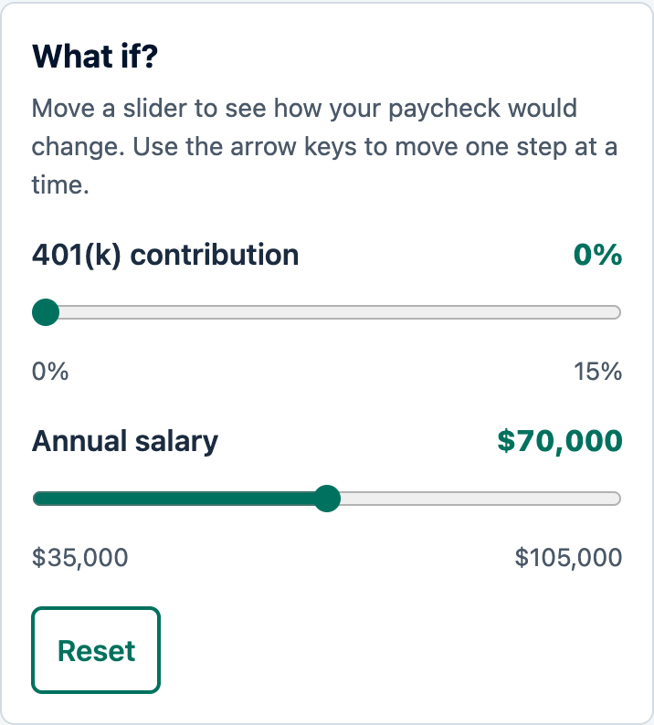
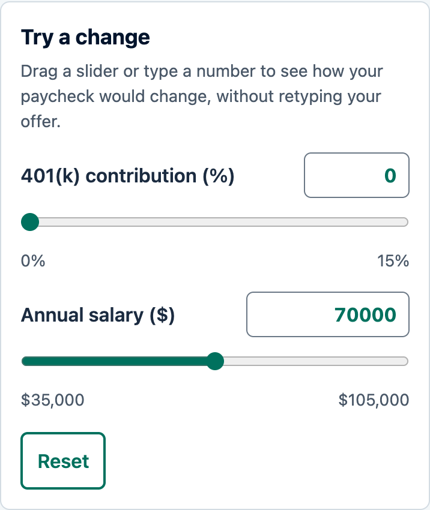

# Usability test

## When

Saturday, November 21, 2026, during MT-haCks.

## Who

One student user, not on our team, who hadn't seen the app before.

## Task

1. Check a job offer's take-home pay.
2. Compare it with a second offer.
3. Try a change using the What-if section.

## What we observed

- She found the app straightforward overall.
- She was confused by the What-if sliders until we explained them.
- She said she would use it and thinks other new grads would too.

## Suggestions from the test

- Type numbers directly instead of using the arrow buttons.
- Keep entered values when switching between the One offer and Compare pages.
- Compare offers side by side.
- Add a budget for rent and food.

## What we changed

Commit a65cf6a:

- Renamed What-if to "Try a change" with clearer instructions.
- Added number boxes next to each slider.
- Removed spinner arrows and added example placeholders.
- Values now carry over between pages.

| Before | After |
| --- | --- |
|  |  |

## Not done yet

- A rent and food budget: out of scope for PayPeek's purpose.
- Weekly or monthly pay: needs backend changes.
